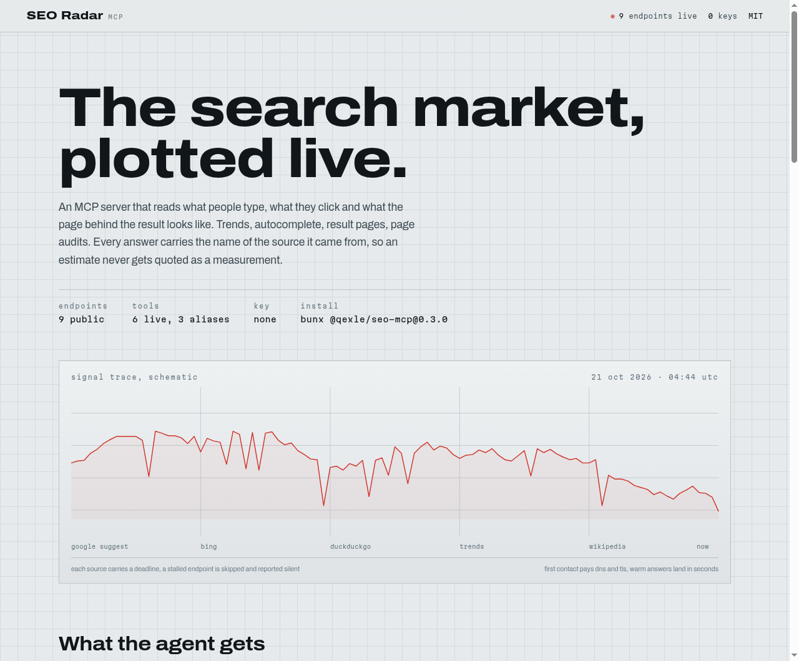
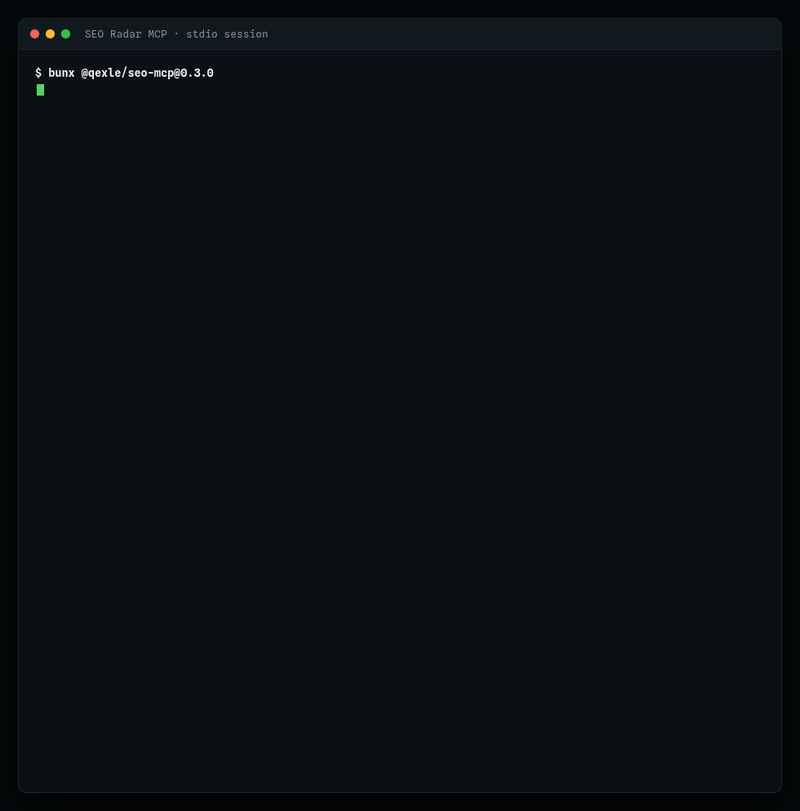

# SEO Radar MCP

<p align="center">
  
</p>

<p align="center">
  <a href="https://www.npmjs.com/package/@qexle/seo-mcp"></a>
  <a href="https://www.npmjs.com/package/@qexle/seo-mcp"></a>
  
  
  
</p>

<p align="center">
  <code>bunx @qexle/seo-mcp@0.3.0</code>
</p>

Live search-market data for LLM agents: Google Trends, autocomplete, result pages and page
audits, read at request time. The server needs no API key.

Your agent asks what the market is doing this week. SEO Radar reads Google's daily
trending searches, Wikipedia's pageview list and the news pack for a niche, then hands
back what that niche is paying attention to. Keyword ideas come from Google, Bing and
DuckDuckGo, with the slot each term holds in the suggestion list. A result-page request
returns the domains ranking today, the news pack beside them, and how contested the term
is.

The server is free, with no account and no usage bill.

## A recorded session

<p align="center">
  
</p>

That is the real server over stdio: the handshake, the tool list, and one
`get_keyword_research` call. The sections below show the raw response from each call.

## What your agent gets

- **Demand ranked by position.** Autocomplete from three engines. Each candidate carries
  its slot in the suggestion list, so you can sort by the order people type.
- **Today's attention.** The Trends daily feed and Wikipedia's pageview list, with a
  niche news pack in the same call.
- **Links that were read.** SEO Radar fetches each candidate page and matches the anchor
  on the page itself.
- **A source on each answer.** `source` names the evidence class, so a reader can tell an
  estimate from a measurement.
- **A deadline on each source.** The server skips a stalled endpoint and answers with
  whatever came back.

## Prompts that work

- "Give me ten article angles for [niche] over the next 30 days, ordered by what people
  are searching for right now."
- "Audit [url] and tell me which checks fail, with the reason each one matters."
- "Who ranks for '[term]' today, and which of them already cover my topic?"
- "Show me the pages that link to [domain], and confirm each link by reading the page."

## Watch it work

I captured these from a cold process on 21 October 2026 and trimmed the keyword and
result-page receipts for length; the values are the ones the server returned.

<details>
<summary><strong>get_keyword_research</strong> · the raw response</summary>

```json
{
  "seed": "technical seo audit",
  "candidates": [
    {
      "keyword": "technical seo audit",
      "autocomplete_rank": 1,
      "engines": ["google", "bing", "duckduckgo"],
      "intent": "informational"
    },
    {
      "keyword": "technical seo audit checklist",
      "autocomplete_rank": 2,
      "engines": ["google", "bing", "duckduckgo"],
      "intent": "informational"
    },
    {
      "keyword": "technical seo audit software",
      "autocomplete_rank": 2,
      "engines": ["bing", "duckduckgo"],
      "intent": "commercial"
    }
  ],
  "questions": [],
  "engines_answered": ["google", "bing", "duckduckgo"],
  "engines_silent": [],
  "source": "autocomplete",
  "note": "Autocomplete shows what people type, not search volume. No volume number is available without a paid keyword API."
}
```

The server returned six. These are the first three.

</details>

<details>
<summary><strong>get_trending</strong> · the raw response</summary>

```json
{
  "geo": "US",
  "trends": [
    {
      "title": "thunder schedule",
      "source": "google_trends",
      "traffic": "1000+",
      "published_at": "Tue, 20 Oct 2026 21:20:00 -0700"
    },
    {
      "title": "toledo",
      "source": "google_trends",
      "traffic": "200+",
      "published_at": "Tue, 20 Oct 2026 21:30:00 -0700"
    }
  ],
  "wikipedia_top": [
    { "title": "Main Page", "source": "wikipedia", "views": 6401058 },
    { "title": "Special:Search", "source": "wikipedia", "views": 872891 }
  ],
  "niche_news": [
    {
      "title": "How to build an AI-powered SEO outreach workflow",
      "source": "bing_news"
    },
    {
      "title": "Google's clutterScore: The hidden SEO risk bloggers can't afford to ignore",
      "source": "bing_news"
    }
  ],
  "source": "trends",
  "note": "No daily search trend matched \"seo\", so the unfiltered daily feed is shown. The niche news list below is filtered."
}
```

</details>

<details>
<summary><strong>get_serp_snapshot</strong> · the raw response</summary>

```json
{
  "keyword": "running shoes",
  "results": [
    {
      "position": 1,
      "title": "Running - Wikipedia",
      "domain": "en.wikipedia.org"
    },
    { "position": 2, "title": "Runner's World", "domain": "runnersworld.com" }
  ],
  "difficulty_estimate": {
    "score": 13,
    "method": "serp_composition",
    "confidence": "low",
    "components": {
      "authority_share": 0.25,
      "domain_concentration": 0,
      "exact_title_share": 0,
      "distinct_domains": 4,
      "results": 4
    },
    "note": "Estimate from the live result page. It is not the Ahrefs keyword difficulty score and it does not use a backlink index."
  },
  "source": "serp"
}
```

</details>

<details>
<summary><strong>get_technical_audit</strong> · the raw response</summary>

```json
{
  "url": "https://example.com",
  "status": 200,
  "https": true,
  "response_ms": 7531,
  "title": "Example Domain",
  "word_count": 25,
  "checks": [
    { "name": "title", "status": "pass", "detail": "title is 14 characters" },
    {
      "name": "meta_description",
      "status": "fail",
      "detail": "meta description is 0 characters"
    },
    {
      "name": "canonical",
      "status": "warn",
      "detail": "no canonical link found"
    },
    { "name": "h1", "status": "fail", "detail": "0 h1 headings" }
  ],
  "score": 42,
  "performance": null,
  "source": "http"
}
```

Twelve checks ran; the four above matter most for a page with no description, no heading
and no canonical.

</details>

### Latency

I measured these on the machine that captured the receipts, with a cold process and no
cache: `get_trending` 3.8s, `get_keyword_research` 12.7s, `get_serp_snapshot` 15.0s,
`get_technical_audit` 7.5s. The first request to a host includes DNS and TLS setup, so a
warm process answers faster. Each source carries a deadline, and when one misses it the
server reports that source silent instead of stalling the call.

## Tools

| Tool                                                  | What it answers                                                            | Where the data comes from                                                             |
| ----------------------------------------------------- | -------------------------------------------------------------------------- | ------------------------------------------------------------------------------------- |
| `get_trending(niche?, geo?, limit?)`                  | What people are searching for right now, filtered to a niche               | Google Trends daily feed, Wikipedia pageviews, Bing news                              |
| `get_keyword_research(seed, limit?, depth?)`          | Which keyword candidates are real, and their shape                         | Google, Bing and DuckDuckGo autocomplete                                              |
| `get_serp_snapshot(keyword, limit?)`                  | Who ranks today, the news pack next to them, and how contested the term is | Live DuckDuckGo result page with a Bing fallback, plus the Bing and Google news feeds |
| `get_technical_audit(url, include_performance?)`      | What is wrong with the page in front of a crawler                          | The page itself, plus the public PageSpeed endpoint when you opt in                   |
| `get_backlinks(domain, limit?)`                       | Which pages link to the domain, confirmed by reading them                  | Result pages plus a fetch of each candidate                                           |
| `get_traffic(domain_or_url, country?, mode?, limit?)` | Reach: referring domains, confirmed backlinks, indexed pages               | The same keyless path, or Ahrefs when a CapSolver key is set                          |

`get_backlinks_list`, `keyword_generator` and `keyword_difficulty` remain as deprecated
aliases, so older configs keep working.

### Read the `source` field

Each response carries a `source` label, and a `tier` when two paths can answer it.

- `autocomplete` - what a search engine suggests for a prefix
- `trends` - trend feeds, pageview counts, news
- `serp` - the live result page
- `http` - a read of the page
- `estimate` - a computed read, built from the signals above
- `ahrefs` - the Ahrefs free tool, used when `CAPSOLVER_API_KEY` is set

A `source` of `estimate` is a model built from measurements. Keep the label when you
quote the number.

## What the keyless path cannot give you

True monthly search volume needs clickstream and advertising data that no public
endpoint exposes. The server prints the autocomplete position instead: how far down a
suggestion list a term sits measures how strongly people type it.

A backlink index the size of Ahrefs' has no public form. The keyless path finds pages
that mention the domain and confirms each link by fetching the page and matching the
target. It finds fewer links, takes longer, and each link it reports is one it read.

Traffic needs the same clickstream data. Without a CapSolver key, `get_traffic` returns
confirmed backlinks, referring domains and the pages the search engine shows, and leaves
the visit count out.

With `CAPSOLVER_API_KEY` set, `get_backlinks`, `get_traffic`, `keyword_generator` and
`keyword_difficulty` answer from the Ahrefs free tool and report `source: "ahrefs"`. That
path needs the paid key and a captcha solver. It is an upgrade, and the server runs
without it.

## Data sources

| Source                   | Used for                              | Key                   |
| ------------------------ | ------------------------------------- | --------------------- |
| Google Suggest           | keyword candidates                    | no                    |
| Bing autosuggest         | keyword candidates                    | no                    |
| DuckDuckGo autocomplete  | keyword candidates                    | no                    |
| Google Trends daily feed | trending searches                     | no                    |
| Wikipedia top pageviews  | trending topics                       | no                    |
| DuckDuckGo lite          | result pages, link discovery          | no                    |
| Bing web and news feeds  | result page fallback, news            | no                    |
| Google News feed         | news pack                             | no                    |
| Page read                | audits, link confirmation             | no                    |
| PageSpeed Insights       | Core Web Vitals                       | no, but quota limited |
| Ahrefs free tool         | backlinks, ideas, difficulty, traffic | `CAPSOLVER_API_KEY`   |

## Requirements

Bun 1.3 or newer, since the server ships as a Bun bundle. Nothing else.

A [CapSolver](https://capsolver.com) key is optional and unlocks the Ahrefs path
described above.

## Install

Run it straight from npm, with no clone and no build step:

```bash
bunx @qexle/seo-mcp@0.3.0
```

Or add it to a project:

```bash
bun add @qexle/seo-mcp
```

## Daily radar

The same three tools write one file per niche per day:

```bash
bunx @qexle/seo-mcp radar --niche "coffee shops in Berlin" --out radar-$(date +%F).md
```

The file holds four sections: what people are searching for now, the keyword
candidates the autocomplete engines accepted, the result page for the
strongest candidate, and the list of sources that answered. Each figure
names its source, including the endpoints that stayed silent.

The command wrote this file on 21 October 2026 for the niche "technical seo
audit", and here it is trimmed to the two tables that carry the signal:

```markdown
## What people search for now

| term                         | source        | traffic |
| ---------------------------- | ------------- | ------- |
| madrid fc                    | google_trends | 2000+   |
| eberechi eze                 | google_trends | 200+    |
| harry kane                   | google_trends | 500+    |
| partidos de champions league | google_trends | 20000+  |
| automaton west               | google_trends | 200+    |

Geo: US
No daily search trend matched "technical seo audit", so the unfiltered daily feed is shown. The niche news list below is filtered.

## Candidate keywords

| keyword                       | intent        | autocomplete rank | engines                  |
| ----------------------------- | ------------- | ----------------- | ------------------------ |
| technical seo audit           | informational | 1                 | google, bing, duckduckgo |
| technical seo audit checklist | informational | 2                 | google, bing, duckduckgo |
| technical seo audit free      | commercial    | 5                 | google, bing, duckduckgo |
| technical seo audit service   | commercial    | 2                 | bing, duckduckgo         |
| technical seo audit software  | commercial    | 2                 | bing, duckduckgo         |

Autocomplete shows what people type, not search volume. No volume number is available without a paid keyword API.

## Result page for "technical seo audit"

| #   | domain                  | title                                                                |
| --- | ----------------------- | -------------------------------------------------------------------- |
| 1   | semrush.com             | Technical SEO Audit: A 10-Step Technical Audit Checklist             |
| 2   | neilpatel.com           | Technical SEO Audit: Tips For Successful Implementation - Neil Patel |
| 3   | moz.com                 | The Technical SEO (& Beyond) Site Audit Checklist - Moz              |
| 4   | searchenginejournal.com | How to Perform an In-Depth Technical SEO Audit                       |
| 5   | webris.org              | The Comprehensive Technical SEO Audit [Checklist]                    |

Difficulty estimate: 20 (low confidence, serp_composition)

Estimate from the live result page. It is not the Ahrefs keyword difficulty score and it does not use a backlink index.

Result page source: rightdao. Pages that did not name the query were dropped.

## Sources

- trends
- autocomplete
- serp

Result page endpoints that stayed silent: duckduckgo
```

The trends table holds the daily feed for the United States because no daily trend
matched the niche, and the file says so instead of showing an empty table. Right Dao
answered while DuckDuckGo returned a challenge page, so the file names the endpoint that
worked and the one that stayed silent. The difficulty number comes from the live page
composition, and the file labels it an estimate rather than a keyword difficulty score.

The `source` field in the tool responses carries the same labels, so an agent
reading the file and an agent calling the tools see the same thing.

The Agent Skill `seo-radar` teaches an agent to build that file on its own:

```bash
npx skills add 1QEXLE/seo-mcp
```

## Usage with MCP clients

### Claude Code

```bash
claude mcp add seo-radar -- bunx @qexle/seo-mcp@0.3.0
```

### OpenCode

```sh
opencode mcp add seo-radar -- bunx @qexle/seo-mcp@0.3.0
```

Or add it to `opencode.jsonc`, global or per project:

```jsonc
{
  "$schema": "https://opencode.ai/config.json",
  "mcp": {
    "servers": {
      "seo-radar": {
        "type": "local",
        "command": ["bunx", "@qexle/seo-mcp@0.3.0"],
        "enabled": true,
      },
    },
  },
}
```

### Claude Desktop

```json
{
  "mcpServers": {
    "seo-radar": {
      "command": "bunx",
      "args": ["@qexle/seo-mcp@0.3.0"]
    }
  }
}
```

### Any MCP client

```json
{
  "mcpServers": {
    "seo-radar": {
      "command": "bunx",
      "args": ["@qexle/seo-mcp@0.3.0"],
      "env": {
        "CAPSOLVER_API_KEY": "optional"
      }
    }
  }
}
```

Pin the version. The server reports its version in the MCP handshake, and a floating tag
lets a breaking change land in the middle of a session.

`index.html` in this repository is a one-page version of the same thing, for readers who
would rather look than read.

## Companion

`[@qexle/qany](https://www.npmjs.com/package/@qexle/qany)` is a keyless search and page
reader with fourteen public sources, a disk cache and its own MCP server. Reach for it when
the topic is the web at large. The search market is the topic here: trends, autocomplete,
result pages and page audits.

## Development

```bash
bun install
bun test          # fails if coverage drops below 100%
bun run typecheck
bunx oxlint .
bun run build
```

The npmjs registry is the default for this package, so a publish needs no registry flag:

```bash
bun publish --registry https://registry.npmjs.org --access public
```

When the npm account has two-factor authentication on, the publish also needs a one-time
code:

```bash
bun publish --registry https://registry.npmjs.org --access public --otp=123456
```

## License

MIT. See [LICENSE](./LICENSE).
